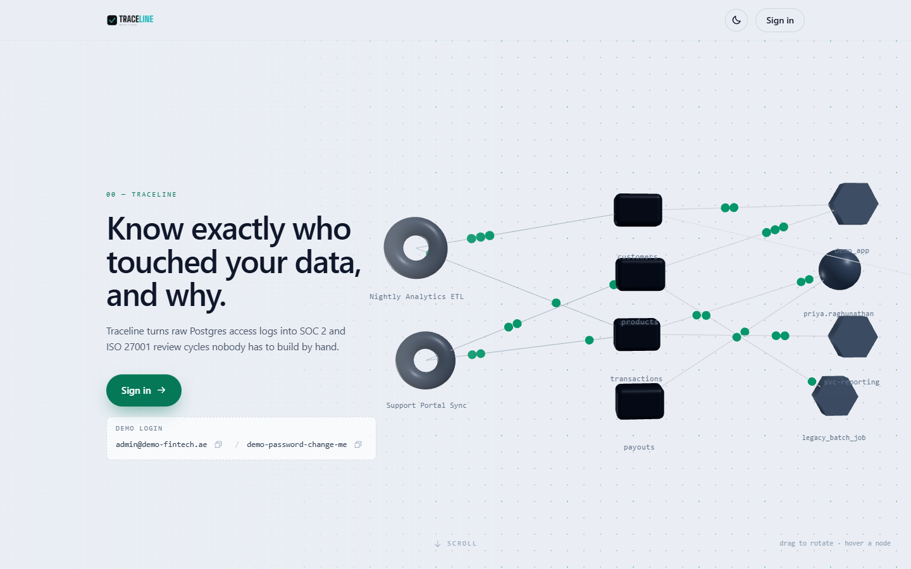
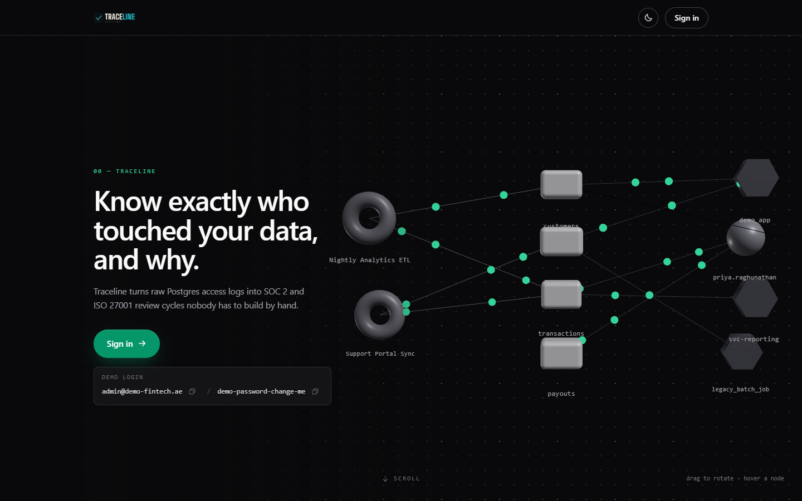
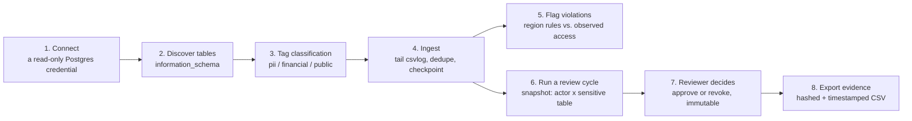
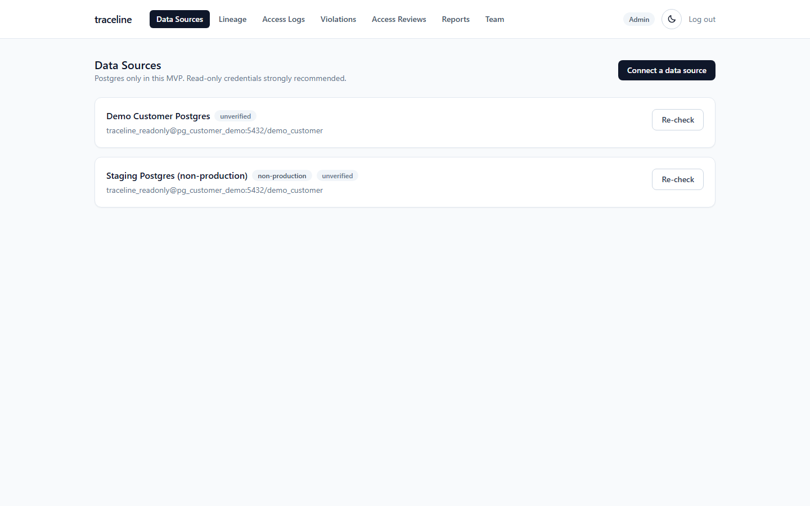
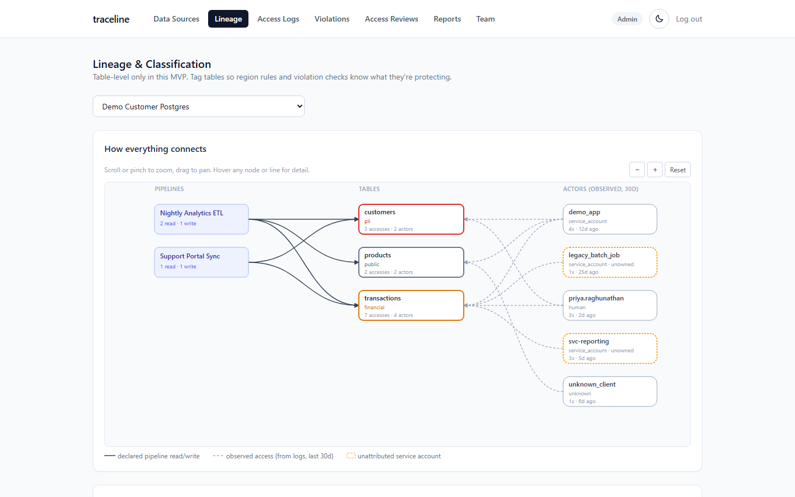
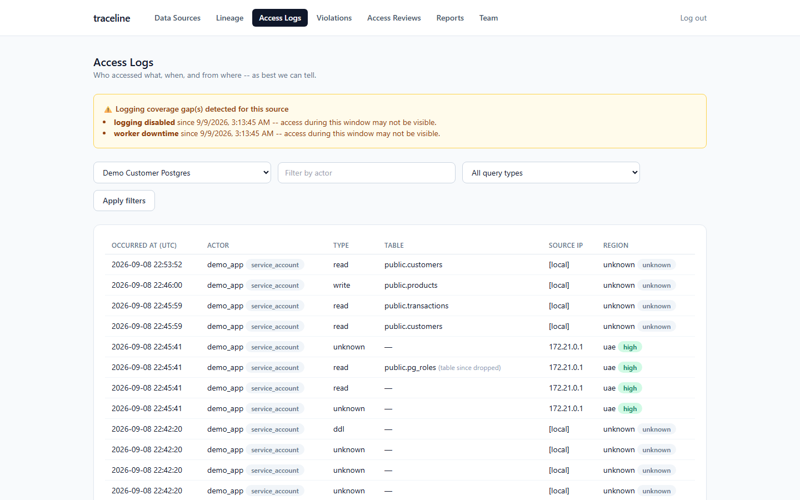
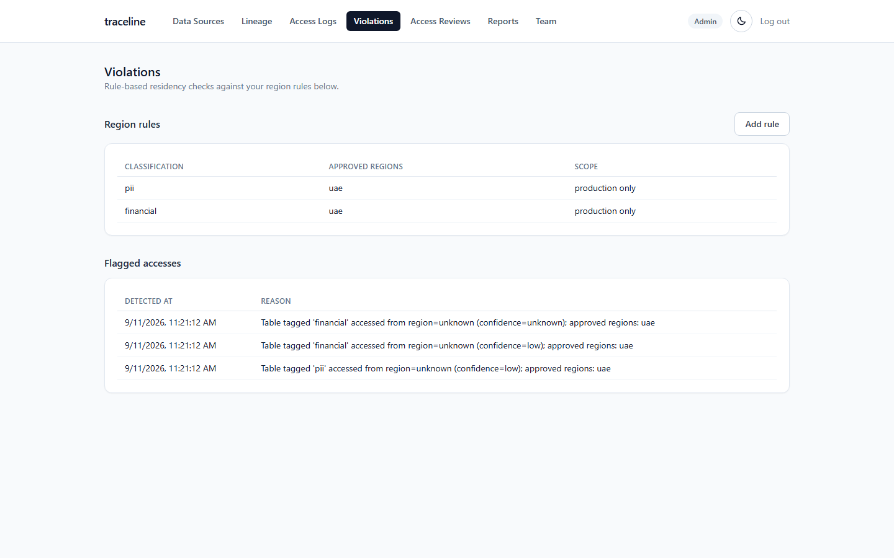
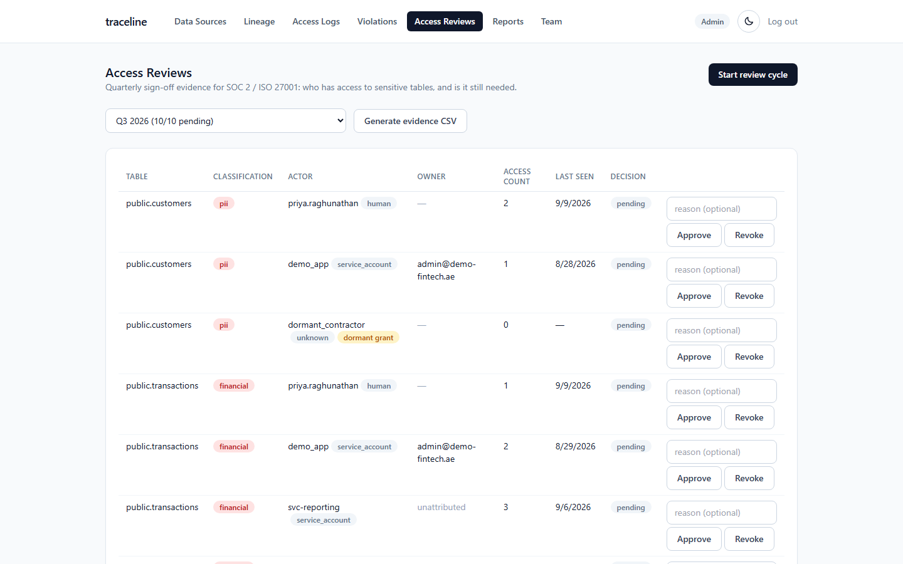
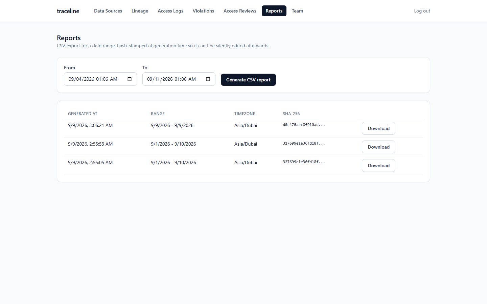
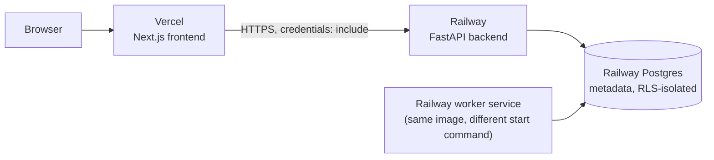

<div align="center">

# Traceline

**Automated, audit-ready database access reviews.**
The part of SOC 2 Type II and ISO 27001 that Vanta, Drata, and Secureframe
still leave as a manual spreadsheet exercise for any company with a
self-hosted or non-standard database.

</div>

<p align="center">
  
</p>

---

## What this actually is

Traceline is a **read-only observability and audit layer**, not an ETL tool
and not a GRC platform. It connects to a customer's existing Postgres,
tails the access log, and turns that into three things a compliance team
and an auditor both want:

1. **A live access log** — who queried what, when, from where, and how
   confident Traceline is about "where."
2. **A residency violation feed** — rule-based flags when sensitive data is
   touched from outside an approved region.
3. **A quarterly access review workflow** — every actor with observed
   access to a sensitive table gets a review item; an authorized reviewer
   approves or revokes it; the decision is immutable and exportable as
   hashed, timestamped evidence.

It's built to be a **complement** to Vanta/Drata/Secureframe (fill their
documented gap around non-standard databases), not a replacement for them.
A secondary, narrower module also covers MENA data-residency rules (PDPL,
DIFC, ADGM, VARA) for teams that need that specifically — see
[Two products, one engine](#two-products-one-engine) below.

<p align="center">
  
</p>

---

## How it works, end to end



Nothing here needs write access to the customer's database and nothing
runs inside their data plane — Traceline only ever reads a log file
Postgres already writes.

---

## Architecture


**Two Postgres roles, deliberately.** Migrations run as a schema-owning
admin role; the API and worker connect as a separate, non-owner role that
Postgres Row-Level Security actually applies to. Every request sets
`app.workspace_id` for its transaction, and RLS enforces that a query can
never see another workspace's rows — even one that forgot its own
`WHERE workspace_id = ...` clause. This is tested, not just claimed: see
`backend/tests/test_tenancy_isolation.py`.

**Ingestion is a passive log tail, not a proxy.** The demo/customer
Postgres runs with stock `log_statement = all` and `logging_collector = on`
— no extension, no agent. The worker tails the resulting csvlog files,
extracts actor / timestamp / table-touched metadata, and discards the raw
query text. Idempotent and resumable: replaying the same log line is a
no-op, and a crash mid-batch never duplicates or drops a record. See
`backend/app/services/connectors/postgres_csvlog.py`.

**Reports are tamper-evident.** Every export is hashed at generation time;
downloading it re-verifies the hash, so a report can't be silently edited
after the fact and still pass as the original.

---

## The product, page by page

### Data Sources
Connect a Postgres instance with a read-only credential. Traceline
validates the role actually has no write grants and flags it if it does,
and shows whether its own logging-coverage check is passing — so you know
what you can and can't see, rather than assuming full coverage.

<p align="center">
  
</p>

### Lineage
Table-level lineage and classification tagging, visualized as a graph —
declared pipeline reads/writes on one side, actors *observed* touching
each table (from the real access log, not a sample) on the other. Scroll
or pinch to zoom, drag to pan, and every node/edge carries enough detail
(access counts, distinct actors, last-seen, owner) to read at a glance —
hover any of them for the full breakdown instead of it all being crammed
onto the node itself.

<p align="center">
  
</p>

### Access Logs
A searchable, filterable feed of every access event: actor, actor type
(human vs. service account), query type, table, source region, and how
confident Traceline is in that region — best-effort labeled, never claimed
as a guarantee.

<p align="center">
  
</p>

### Violations
Region rules (e.g. "PII must stay in `uae`") evaluated against real
access events. Non-production sources can be excluded so staging traffic
doesn't drown out signal.

<p align="center">
  
</p>

### Access Reviews
The core of the product. Generate a review cycle, get one item per
(sensitive table, actor) pair — sourced from observed access in the
lookback window, a live database GRANT found at generation time, or both,
labeled accordingly so a dormant-but-still-granted permission can't hide
behind "nobody's queried it lately" — and approve or revoke each one.
Decisions are permanent once made — a wrong call is corrected by the
*next* cycle, never by editing history.

<p align="center">
  
</p>

### Reports
Two export types, both hashed and timestamped: a raw access-log CSV for a
date range, and an access-review evidence CSV shaped the way an auditor
actually wants to see it — table, actor, owner, decision, reviewer, date.

<p align="center">
  
</p>

### Team
Manage who's an authorized reviewer (a separate flag from admin — a
manager can review without being a Traceline admin) and attribute service
accounts to a real person, so a pipeline credential never shows up as
unowned "system" noise in a review.

---

## Two products, one engine

Traceline's positioning shifted during development, and both angles are
still live in the code:

| | Primary: SOC 2 / ISO 27001 access reviews | Secondary: MENA data residency |
|---|---|---|
| Buyer | Eng lead / CTO at a Series A-C SaaS company, or a fractional CISO/vCISO firm | Compliance officer / DPO at a DIFC/ADGM-regulated fintech |
| What it proves | Quarterly access review, signed and exportable | PDPL/DIFC/ADGM/VARA region-rule compliance |
| Positioning | Complement to Vanta/Drata/Secureframe | Standalone audit layer |

Same tables, same ingestion, same tenancy model underneath — the review
workflow and the region-rule engine are just two different consumers of
the same `access_event` stream.

---

## Tech stack

| Layer | Choice | Why |
|---|---|---|
| Backend | FastAPI + SQLAlchemy 2.0 + Alembic | typed, async-capable, migration-first |
| Metadata store | Postgres, own instance | never shares infrastructure with what it's auditing |
| Worker | APScheduler, in-process | one fewer moving part than Celery/Redis for this workload |
| Auth | Self-hosted JWT (httpOnly cookie) | no external account dependency for an MVP |
| Frontend | Next.js 14 (App Router) + Tailwind + Motion | real interactivity, not a static marketing shell |
| Tenancy | App-level filtering + Postgres RLS | defense in depth, not either/or |

---

## Running it locally

```bash
git clone <this repo> traceline && cd traceline
cp .env.example .env
docker compose up -d pg_metadata pg_customer_demo

cd backend
alembic upgrade head
python -m scripts.seed_demo      # creates a demo workspace, user, data source,
                                  # sample pipelines, and region rules

cd ..
docker compose up -d             # backend + worker + frontend
```

Open **http://localhost:3001**. The seed script creates three logins, one
per role tier, all with password `demo-password-change-me`:

| Email | Role | Authorized reviewer |
|---|---|---|
| `admin@demo-fintech.ae` | admin | yes |
| `reviewer@demo-fintech.ae` | reviewer | yes |
| `viewer@demo-fintech.ae` | viewer | no |

Log in as each to see the difference -- a viewer can't connect a data
source, tag a table, or decide a review item; a reviewer can decide but
can't manage configuration; only an admin can do both. The backend
enforces this independently of what the frontend shows (`app.api.deps.
require_role`), so it's a real boundary, not cosmetic.

The seed script also inserts enough realistic synthetic data to exercise
every page's edge cases on the very first run, without you having to
manufacture a scenario by hand:

- A second, non-production data source alongside the primary one, so you
  can see "exclude staging from violation checks" actually holding --
  same kind of out-of-region PII access on both sources, but a violation
  only on the production one.
- An open logging-coverage gap, so the Access Logs banner shows
  immediately instead of waiting for a real worker outage.
- Access events covering every `query_type` (`read`/`write`/`ddl`/
  `unknown`) and every `region_confidence` tier, including one event with
  no source IP at all (`unknown`, no CIDR match possible).
- Two region rules (`pii`, `financial`) and the residency violations they
  produce on real out-of-region events -- run through the actual rule
  engine, not hand-inserted rows.
- Two review cycles: an older one, backdated, mostly decided (a mix of
  approved/revoked with reasons) with one item deliberately left pending
  long enough to show the "stale" badge, plus its own evidence report;
  and a fresh one, fully pending, for you to actually work through. Both
  include a `granted_only` ("dormant grant") item -- a live GRANT with no
  matching access in the log -- guaranteed to exist even if this session's
  live grant introspection doesn't happen to produce one itself.
- `svc-reporting` stays deliberately unowned, so the "unattributed
  service account" warning has something real to point at.

It skips this step entirely once real data exists, so it never overwrites
genuine ingestion with synthetic data. The worker starts tailing the
bundled demo Postgres immediately after -- give it a few polling cycles
and the Access Logs page will have live data layered on top.

> **Note:** the frontend runs on host port **3001**, not 3000, to avoid
> colliding with other local projects. The backend API is on 8000.

### Running the tests

```bash
cd backend
alembic upgrade head    # against the running pg_metadata container
pytest
```

Covers, against a real Postgres instance (never mocked): multi-tenancy
isolation (including a raw SQL query that "forgets" its own workspace
filter), ingestion idempotency and resumability, report tamper-evidence,
and access-review edge cases (unauthorized-reviewer rejection, decision
immutability, sensitive-tag-only item generation).

---

## Deploying it (demo purposes)

**Vercel cannot host the backend or the worker.** It's a serverless/edge
platform for the Next.js frontend; it has no facility for a persistent
FastAPI process or a worker that polls on an interval forever (functions
there are ephemeral and time-limited). The split below is real, not a
formality: frontend on Vercel, everything stateful on Railway.



### 1. Backend + worker + metadata Postgres, on Railway

1. Create a Railway project. Add a **Postgres** plugin -- this is
   `pg_metadata`; Railway gives you one connection string for a
   superuser-like role. Note its host/port/database.
2. Create a service from this repo with **root directory = `backend`**.
   Railway will detect `backend/Dockerfile` and `backend/railway.json`
   (start command, health check at `/health`). Set its environment:
   - `DATABASE_URL` = the Postgres plugin's connection string, with the
     driver prefix changed to `postgresql+psycopg://` (Railway gives you
     a plain `postgresql://` one).
   - `APP_DATABASE_URL` = the **same** host/port/database, but
     `traceline_app` as both user and password -- that role doesn't exist
     yet; migration 0001 creates it the first time this service deploys.
     **Rotate that password for anything beyond a demo** (see Known
     limitations) -- it's a fixed value in the migration, fine only
     because this role is never reachable from outside Railway's private
     network.
   - `JWT_SECRET` -- generate one: `python -c "import secrets; print(secrets.token_urlsafe(48))"`
   - `CREDENTIALS_ENCRYPTION_KEY` -- generate one: `python -c "from cryptography.fernet import Fernet; print(Fernet.generate_key().decode())"`
   - `CORS_ALLOWED_ORIGINS` = your Vercel URL (set after step 2 below;
     redeploy once you have it).
   - `COOKIE_SECURE=true`, `COOKIE_SAMESITE=none` -- **required**, not
     optional, because the frontend and backend are on different origins.
     A `Lax` cookie is silently never sent cross-site no matter what the
     frontend's `fetch` call says.
3. Create a **second** service, same repo, same root directory
   (`backend`), same environment variables as step 2 -- but override its
   **Start Command** (Settings → Deploy) to `python -m app.worker.scheduler`.
   This is the ingestion worker. It will run with no data source
   configured (there's no live customer Postgres deployed alongside it,
   see below) and simply idle.
4. Run the seed script once, against Railway's `DATABASE_URL`/
   `APP_DATABASE_URL` (`railway run python -m scripts.seed_demo` from the
   `backend` directory, or open a one-off shell on the service). This is
   what actually populates the hosted demo -- see the next section.

**The hosted demo is a frozen, seeded dataset, not live ingestion, and
that's a deliberate choice, not a corner cut.** Reproducing docker-
compose's shared log-file volume between a worker and a second Postgres
instance across separate Railway services is real infrastructure work
that would only prove "the demo environment can run Postgres," not
anything about the product. The seed script (`scripts/seed_demo.py`) runs
the *actual* review-cycle-generation and report-generation code against
realistic synthetic access events, so what you see -- the access log, the
one flagged violation, the completed review cycle, the two downloadable
reports with valid hashes -- is genuinely produced by Traceline's own
code, just from seeded rather than tailed input. Run it locally via
`docker compose` (above) to see the real live-ingestion path end to end.

### 2. Frontend, on Vercel

1. Import this repo into Vercel. Set **Root Directory = `frontend`** --
   Vercel auto-detects Next.js from there, no config file needed.
2. Set the environment variable `NEXT_PUBLIC_API_BASE_URL` to your
   Railway backend service's public URL (Settings → Networking →
   Generate Domain on that service if it doesn't have one yet).
3. Deploy. Then go back to the Railway backend service and set
   `CORS_ALLOWED_ORIGINS` to the Vercel URL you just got, and redeploy it
   -- the two need each other's URLs, so this is a one-time back-and-forth
   on first setup.

---

## Project structure

```
traceline/
  docker-compose.yml
  customer-pg-demo/         # stand-in "customer" Postgres for local dev/tests
  backend/
    railway.json             # Railway deploy config (backend service)
    alembic/                 # migrations, incl. Postgres RLS policies
    app/
      core/                  # config, JWT auth, Fernet credential encryption
      db/                    # two-engine session setup (admin vs. RLS-scoped)
      models/                 # SQLAlchemy models
      api/routers/            # FastAPI endpoints, incl. require_role-gated ones
      services/
        connectors/           # SourceConnector interface + Postgres csvlog implementation
        ingestion.py           # checkpointing, dedupe, coverage-gap detection
        violations.py          # rule-based residency violation engine
        access_review.py       # review cycle generation (incl. GRANT introspection) + decisions
        region.py               # CIDR map + opt-in IP geolocation, with caching
        reports.py              # CSV export + SHA-256 hashing
      worker/scheduler.py      # APScheduler polling loop
    scripts/seed_demo.py       # idempotent local/cloud demo data (real + synthetic)
    tests/                     # tenancy isolation, idempotency, reports, access review, rbac, region
  frontend/
    app/                       # marketing site (/) + login + (dashboard) route group
    components/marketing/      # landing page components (Motion + Phosphor icons)
    lib/CurrentUserContext.tsx  # role/can_review, read by pages to gate UI (backend re-checks independently)
```

---

## Deliberately not built

These were evaluated and deliberately left out, not overlooked. None of
them would have made the demo better -- each is a multi-week build in its
own right, and several (real IdP SSO, an actual Vanta/Drata webhook) can't
be meaningfully built at all without a live third-party account to
integrate against:

- **Additional source connectors** (Snowflake, BigQuery) — the
  `SourceConnector` interface exists so these slot in later without
  touching ingestion or the data model.
- **ML-based PII detection** — classification is manual tagging by design
  (spec section 2); auto-detection is a different, much larger product.
- **Column-level lineage** — table-level only.
- **Self-serve signup/billing** — workspaces and users are seeded/created
  directly.
- **A real Vanta/Drata webhook integration** — the natural fast-follow
  once the core workflow is validated with paying customers; there's
  nothing to integrate against without one of their accounts.
- **Real IdP/SSO integration** (Okta, Azure AD) for actor identity — same
  reasoning: nothing to build against without a live tenant. The
  human-vs-service-account split today is a naming-convention heuristic
  (see Known limitations).
- **HR/IdP-triggered offboarding reviews** — depends on the above.
- **Cross-system identity resolution** — a person with separate logins in
  different systems still shows up as unrelated actors. Solving this in
  general is a research-grade identity-graph problem, not a demo feature.

## What was closed since the original MVP pass

The original MVP write-up (see git history) listed several honest gaps.
Three of them were closed, and one was upgraded from "manual only" to
"manual, with an opt-in automated assist":

- **Live GRANT introspection**, alongside observed access. A review cycle
  now queries `pg_class.relacl` (via Postgres's `aclexplode()`) on the
  live source at generation time, not just the access log — so a role
  that was granted `SELECT` but hasn't queried the table recently still
  surfaces as a `granted_only` item, tagged distinctly from `observed` and
  `both`. This is the actual gap a purely log-based review would miss,
  and it's covered by both a live end-to-end test (real GRANT, real
  Postgres) and a unit test for the case where the source is unreachable
  (degrades to observed-only for that source, doesn't fail the cycle).
  Note `information_schema.role_table_grants` was tried first and
  rejected: it only shows a grant if the *connecting* role is the grantor
  or grantee, so a read-only credential silently missed every grant made
  by someone else -- `pg_class.relacl` doesn't have that restriction.
- **Opt-in IP geolocation** for region confidence (`ip-api.com`, no API
  key), layered *behind* the manual CIDR map, not replacing it: the CIDR
  map is checked first and always wins if it matches. Off by default per
  workspace (`Workspace.enable_ip_geolocation`) -- sending an access IP to
  a third party is itself a privacy-relevant choice for a security
  product, so it's the customer's call, not a silent default. A private/
  internal IP is never sent externally regardless of the setting.
  Results cache per workspace so a repeated IP costs one lookup, not one
  per event.
- **Role tiers**: `admin` / `reviewer` / `viewer`, enforced server-side
  (`app.api.deps.require_role`, re-checked fresh per request, not baked
  into the JWT) on every mutating endpoint, and reflected in the frontend
  so a viewer doesn't see a button that would just 403. `can_review`
  stays a separate flag from role, per the original design: "can
  administer the workspace" and "is an authorized reviewer" are different
  questions.
- **Best-effort table extraction got measurably better** without becoming
  a full parser (still explicitly out of scope): schema-qualified names
  (`billing.invoices`) previously resolved to the wrong table entirely,
  because `sqlparse` tokenizes `schema.table` as three tokens, not one --
  the old code only looked at the first. Postgres's `UPDATE ONLY table`
  syntax was also silently unhandled. Both are fixed and covered by tests.
- **The lineage graph is now zoomable/pannable**, not a fixed-size SVG --
  scroll or pinch to zoom toward the cursor, drag to pan, a reset button
  to snap back. Every node/edge got more at-a-glance detail (access
  counts, distinct actors, last-seen, owner) with the rest available on
  hover, rather than either cramming everything onto the node or hiding
  it behind a click-through.
- **Demo data now covers every scenario end to end** (see [Running it
  locally](#running-it-locally)) -- a non-production data source proving
  the violation-scoping exclusion, an open coverage gap, every
  `query_type`/`region_confidence` combination, two region rules, two
  review cycles (one historical with real decisions and a stale item, one
  fresh), and a guaranteed dormant-grant item -- so a demo doesn't depend
  on asking questions or manually engineering a scenario first.
- **Dark mode now covers the whole app**, not just the marketing site and
  login. The dashboard's shared component classes (`.card`, `.btn-*`,
  `.input`, `table.data-table`) and every page picked up `dark:` variants,
  and a theme toggle was added to the dashboard nav -- same `dark` class
  and `localStorage` mechanism the marketing site already used, just no
  longer scoped away from the product itself.

## Known limitations

- Table-name extraction remains best-effort (`sqlparse`, not a full SQL
  parser) -- by design, not an oversight. A statement whose table
  reference doesn't match the recognized patterns yields no table, not a
  wrong one.
- Actor human-vs-service-account classification is a naming-convention
  heuristic, not an identity provider integration.
- Geolocation accuracy is whatever a free, keyless provider gives you --
  labeled "medium confidence" for exactly that reason, never presented as
  a guarantee. It also only speaks country codes, not the fine-grained
  regions a `region_rule` might use.
- No cross-system identity resolution: the same person with separate
  logins in different systems shows up as unrelated actors.
- The `traceline_app` database role's password is a fixed value created by
  migration 0001, meant for a private network only (the app/worker
  connecting to their own metadata Postgres). Fine for local Docker,
  where nothing external can reach that Postgres; rotate it if you deploy
  somewhere it might be reachable beyond your own services network (see
  "Deploying it").
