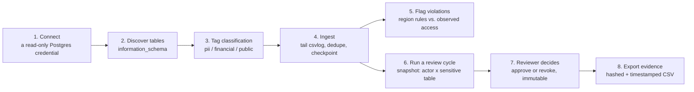
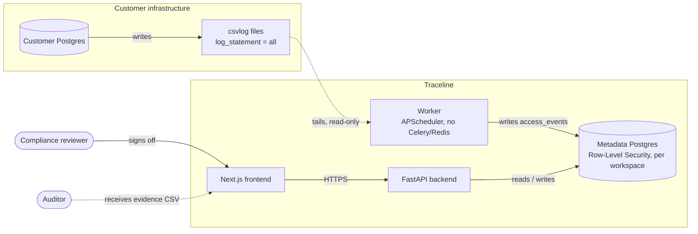

<div align="center">

# Traceline

**Automated, audit-ready database access reviews.**
The part of SOC 2 Type II and ISO 27001 that Vanta, Drata, and Secureframe
still leave as a manual spreadsheet exercise for any company with a
self-hosted or non-standard database.

</div>

<p align="center">
  
</p>

---

## What this actually is

Traceline is a **read-only observability and audit layer**, not an ETL tool
and not a GRC platform. It connects to a customer's existing Postgres,
tails the access log, and turns that into three things a compliance team
and an auditor both want:

1. **A live access log** — who queried what, when, from where, and how
   confident Traceline is about "where."
2. **A residency violation feed** — rule-based flags when sensitive data is
   touched from outside an approved region.
3. **A quarterly access review workflow** — every actor with observed
   access to a sensitive table gets a review item; an authorized reviewer
   approves or revokes it; the decision is immutable and exportable as
   hashed, timestamped evidence.

It's built to be a **complement** to Vanta/Drata/Secureframe (fill their
documented gap around non-standard databases), not a replacement for them.
A secondary, narrower module also covers MENA data-residency rules (PDPL,
DIFC, ADGM, VARA) for teams that need that specifically — see
[Two products, one engine](#two-products-one-engine) below.

<p align="center">
  
</p>

---

## How it works, end to end



Nothing here needs write access to the customer's database and nothing
runs inside their data plane — Traceline only ever reads a log file
Postgres already writes.

---

## Architecture



**Two Postgres roles, deliberately.** Migrations run as a schema-owning
admin role; the API and worker connect as a separate, non-owner role that
Postgres Row-Level Security actually applies to. Every request sets
`app.workspace_id` for its transaction, and RLS enforces that a query can
never see another workspace's rows — even one that forgot its own
`WHERE workspace_id = ...` clause. This is tested, not just claimed: see
`backend/tests/test_tenancy_isolation.py`.

**Ingestion is a passive log tail, not a proxy.** The demo/customer
Postgres runs with stock `log_statement = all` and `logging_collector = on`
— no extension, no agent. The worker tails the resulting csvlog files,
extracts actor / timestamp / table-touched metadata, and discards the raw
query text. Idempotent and resumable: replaying the same log line is a
no-op, and a crash mid-batch never duplicates or drops a record. See
`backend/app/services/connectors/postgres_csvlog.py`.

**Reports are tamper-evident.** Every export is hashed at generation time;
downloading it re-verifies the hash, so a report can't be silently edited
after the fact and still pass as the original.

---

## The product, page by page

### Data Sources
Connect a Postgres instance with a read-only credential. Traceline
validates the role actually has no write grants and flags it if it does,
and shows whether its own logging-coverage check is passing — so you know
what you can and can't see, rather than assuming full coverage.

<p align="center">
  
</p>

### Lineage
Table-level lineage and classification tagging, visualized as a graph —
declared pipeline reads/writes on one side, actors *observed* touching
each table (from the real access log, not a sample) on the other.

<p align="center">
  
</p>

### Access Logs
A searchable, filterable feed of every access event: actor, actor type
(human vs. service account), query type, table, source region, and how
confident Traceline is in that region — best-effort labeled, never claimed
as a guarantee.

<p align="center">
  
</p>

### Violations
Region rules (e.g. "PII must stay in `uae`") evaluated against real
access events. Non-production sources can be excluded so staging traffic
doesn't drown out signal.

<p align="center">
  
</p>

### Access Reviews
The core of the product. Generate a review cycle, get one item per
(sensitive table, actor) pair with observed access in the lookback window,
and approve or revoke each one. Decisions are permanent once made — a
wrong call is corrected by the *next* cycle, never by editing history.

<p align="center">
  
</p>

### Reports
Two export types, both hashed and timestamped: a raw access-log CSV for a
date range, and an access-review evidence CSV shaped the way an auditor
actually wants to see it — table, actor, owner, decision, reviewer, date.

<p align="center">
  
</p>

### Team
Manage who's an authorized reviewer (a separate flag from admin — a
manager can review without being a Traceline admin) and attribute service
accounts to a real person, so a pipeline credential never shows up as
unowned "system" noise in a review.

---

## Two products, one engine

Traceline's positioning shifted during development, and both angles are
still live in the code:

| | Primary: SOC 2 / ISO 27001 access reviews | Secondary: MENA data residency |
|---|---|---|
| Buyer | Eng lead / CTO at a Series A-C SaaS company, or a fractional CISO/vCISO firm | Compliance officer / DPO at a DIFC/ADGM-regulated fintech |
| What it proves | Quarterly access review, signed and exportable | PDPL/DIFC/ADGM/VARA region-rule compliance |
| Positioning | Complement to Vanta/Drata/Secureframe | Standalone audit layer |

Same tables, same ingestion, same tenancy model underneath — the review
workflow and the region-rule engine are just two different consumers of
the same `access_event` stream.

---

## Tech stack

| Layer | Choice | Why |
|---|---|---|
| Backend | FastAPI + SQLAlchemy 2.0 + Alembic | typed, async-capable, migration-first |
| Metadata store | Postgres, own instance | never shares infrastructure with what it's auditing |
| Worker | APScheduler, in-process | one fewer moving part than Celery/Redis for this workload |
| Auth | Self-hosted JWT (httpOnly cookie) | no external account dependency for an MVP |
| Frontend | Next.js 14 (App Router) + Tailwind + Motion | real interactivity, not a static marketing shell |
| Tenancy | App-level filtering + Postgres RLS | defense in depth, not either/or |

---

## Running it locally

```bash
git clone <this repo> traceline && cd traceline
cp .env.example .env
docker compose up -d pg_metadata pg_customer_demo

cd backend
alembic upgrade head
python -m scripts.seed_demo      # creates a demo workspace, user, data source,
                                  # sample pipelines, and region rules

cd ..
docker compose up -d             # backend + worker + frontend
```

Open **http://localhost:3001**. Log in with the credentials the seed
script printed (defaults to `admin@demo-fintech.ae` /
`demo-password-change-me`). The worker starts ingesting from the bundled
demo Postgres immediately — give it a few polling cycles and the Access
Logs page will have real data.

> **Note:** the frontend runs on host port **3001**, not 3000, to avoid
> colliding with other local projects. The backend API is on 8000.

### Running the tests

```bash
cd backend
alembic upgrade head    # against the running pg_metadata container
pytest
```

Covers, against a real Postgres instance (never mocked): multi-tenancy
isolation (including a raw SQL query that "forgets" its own workspace
filter), ingestion idempotency and resumability, report tamper-evidence,
and access-review edge cases (unauthorized-reviewer rejection, decision
immutability, sensitive-tag-only item generation).

---

## Project structure

```
traceline/
  docker-compose.yml
  customer-pg-demo/         # stand-in "customer" Postgres for local dev/tests
  backend/
    alembic/                # migrations, incl. Postgres RLS policies
    app/
      core/                 # config, JWT auth, Fernet credential encryption
      db/                   # two-engine session setup (admin vs. RLS-scoped)
      models/                # SQLAlchemy models
      api/routers/           # FastAPI endpoints
      services/
        connectors/          # SourceConnector interface + Postgres csvlog implementation
        ingestion.py          # checkpointing, dedupe, coverage-gap detection
        violations.py         # rule-based residency violation engine
        access_review.py      # review cycle generation + decision recording
        reports.py            # CSV export + SHA-256 hashing
      worker/scheduler.py     # APScheduler polling loop
    tests/                    # tenancy isolation, idempotency, reports, access review
  frontend/
    app/                      # marketing site (/) + login + (dashboard) route group
    components/marketing/     # landing page components (Motion + Phosphor icons)
```

---

## Deliberately not built yet

- Additional source connectors (Snowflake, BigQuery) — the
  `SourceConnector` interface exists so these slot in without touching
  ingestion or the data model.
- ML-based PII detection — classification is manual tagging by design.
- Column-level lineage — table-level only.
- Granular RBAC — a single admin role per workspace, plus the separate
  `can_review` reviewer flag.
- Self-serve signup/billing — workspaces and users are seeded/created
  directly.
- Vanta/Drata webhook export — the natural fast-follow once the core
  workflow is validated with real customers.
- HR/IdP-triggered offboarding reviews.

## Known limitations

- "Has access" in a review cycle means *observed* access (a matching log
  entry in the lookback window), not a live GRANT introspection — a
  dormant, still-granted permission that hasn't been used recently won't
  appear as an item.
- Table-name extraction from SQL text is best-effort (`sqlparse`), not a
  full parser.
- Actor human-vs-service-account classification is a naming heuristic, not
  an identity provider integration.
- Region detection only ever as good as the workspace's manually
  configured IP/CIDR map — no live cloud-metadata lookup.
- No cross-system identity resolution: the same person with separate
  logins in different systems shows up as unrelated actors.
